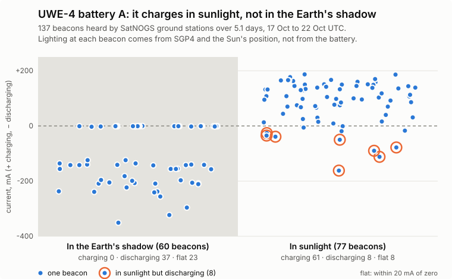
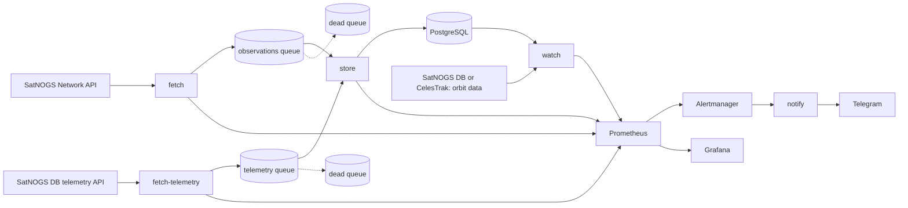

# satnogs-pipeline

Reads the radio telemetry of real CubeSats from volunteer ground stations, decodes it, stores it, and raises an alert when a battery misbehaves. Five satellites so far: [UWE-4](https://en.wikipedia.org/wiki/UWE-4) (University of Würzburg), CatSat, SNUGLITE, Sharjahsat-1 and GRBBeta. The alert knows whether the satellite is in sunlight or in the Earth's shadow, because a battery is supposed to discharge in the shadow.



The data comes from [SatNOGS](https://satnogs.org/), a worldwide network of volunteer ground stations. The lighting is worked out with the SGP4 orbit model from [orbitscreen](https://github.com/supremeinferno/orbitscreen) and the Sun's position, not read from the battery, which is what makes the picture above a check and not a circle.

## What it does



## Results

Measured on real data from 14 to 22 October 2026, unless it says otherwise. The lighting check below is UWE-4's (137 beacons over 5.1 days); the others are newer to the pipeline and have less history.

| | |
|---|---|
| Satellites | 5 satellites, 6 batteries: UWE-4 (2 batteries, voltage, current, temperature, charge), CatSat and Sharjahsat-1 (voltage and current), SNUGLITE and GRBBeta (voltage only). 366 distinct beacons stored by 22 October, before GRBBeta was added on the 23rd. |
| Lighting model against the batteries | In the shadow, **0 of 60** beacons were charging. In sunlight, 61 of 77 were. |
| Battery rules on the same history | Replayed at each of the 137 UWE-4 readings, "discharging in sunlight" and "low voltage" never fired. The "below its own baseline" rule gave 14 false alarms in 138 readings with a short baseline and none with the one it has now, but it was only active for about two days of that history: see [Battery watch](#battery-watch). |
| Same rule on made-up readings | Three in the shadow at -300 mA (what "current is negative" would flag): no alert. Three in sunlight at -120 mA: alert, delivered to Telegram, resolved when removed. |
| Failure tests ([`scripts/chaos.sh`](scripts/chaos.sh)) | 6 breakages, 20 checks, 30 to 45 seconds, on Docker Compose and on Kubernetes: store down, RabbitMQ restart, PostgreSQL down, duplicates, a message that is not JSON. |
| Throughput of `store` | 5,400 observations per second with one replica, 8,000 with two, 8,900 with four (draining a 20,000-message queue, Docker Compose on a laptop). See [Performance](#performance). |
| Time in the pipeline | Published to stored: median 0.1 to 0.7 ms, 99th percentile under 7 ms, at 100 to 2,000 messages per second with one replica. |
| CI | gofmt, vet, tests with the race detector, `go.mod`, shell scripts, Prometheus and Alertmanager configuration, Kubernetes manifests (kubeconform), Docker image. Dependabot proposes updates to Go modules, GitHub Actions and Docker images. |
| Kubernetes (kind) | 11 pods running without restarts, 5 Prometheus targets up, 10 alert rules loaded. |

## Where the real data corrected me

- The SatNOGS API's `status` filter still returns passes that have not happened yet, and for a busy satellite the first 140 results are all in the future. Filtering is done here, with a time cutoff.
- 38 of the first 72 telemetry frames have `observation_id` 0 (not uploaded through SatNOGS Network). I had treated that as invalid and sent good frames to the dead queue. They are stored with a NULL observation now.
- The telemetry API answers 429 every eight to ten seconds. A poll that failed on it started over from the first page and never finished. It now waits out the 429 on the same page.
- Most satellites' frames are no use: Morse code and APRS text carry no battery data. 75 satellites were scanned (slowly, because of that rate limit) to find one with a binary, documented beacon.
- The first version of the "below its own baseline" rule (4% under the median of 8 or more readings) fired 14 times in 138 UWE-4 readings. Its sunlit voltage sits at 4.20 V when charging and near 4.05 V when not, and a short baseline sees one of the two. The rule now needs 40 readings over 3 days.
- The format definitions I wanted to turn into decoders are AGPL-3.0, which I only checked after planning to use them. The project is AGPL-3.0 now; see [License](#license).
- Not every format can be generated: Celesta's Go parser does not compile (the generator puts -1 into a uint8). Each satellite has to be tried. GRBBeta's did not compile either: its definition switches on the first 8 bytes of a frame (`0x6465206861326772`, "de ha2gr"), and the YAML reader turned that into a JavaScript number and lost its last digits. [`gen.js`](scripts/kaitai/gen.js) now keeps such numbers exact.
- The frames SatNOGS DB files under UNISAT-6 are UNISAT-7's: 200 of 200 recent ones start with "US7" or the text "UniSat-7", and UNISAT-6's format expects "US6". There is no UNISAT-7 definition, so neither is watched.
- Sharjahsat-1's battery current has the opposite sign to UWE-4's and CatSat's: positive means discharging. Its format definition does not say so; only the lighting did.
- One beacon with the battery discharging in sunlight is not an anomaly: 8 of 77 sunlit beacons do it, for a few tens of mA. The rule asks for three, 30 minutes apart.

## How it fits together

Five programs in one binary, so that a slow or dead part never stops the others:

- `fetch` polls the observations API on an interval, follows its pagination, skips passes that haven't happened yet, and publishes each new or changed observation. It waits for the broker's confirmation (publisher confirms) before counting a message as sent.
- `store` reads the queue and writes to Postgres. A message is acknowledged only after it is saved, so a crash loses nothing; an undecodable or invalid message goes to the dead queue instead of blocking the rest.
- `fetch-telemetry` reads raw radio frames of every satellite in the registry (or those given with `-satellites`) from the SatNOGS DB API, which needs an account token (`SATNOGS_DB_TOKEN` in `.env`), and respects its rate limit (HTTP 429, `Retry-After`). `store` decodes each frame with the satellite's decoder (below) into one reading per battery, and keeps one row per distinct frame and battery: the same beacon heard by two ground stations is stored once. Frames that carry no battery data, arrive damaged or hold an implausible voltage are counted and dropped; only frames that can never work (bad JSON, an unknown satellite) go to the dead queue.
- `watch` applies battery rules that know whether each satellite is in sunlight (see [Battery watch](#battery-watch)) and exports the result as metrics.
- `notify` receives Alertmanager's webhook and sends each alert to Telegram (see [Alerts](#alerts)).
**Satellites and decoders.** `satellites.go` lists what the pipeline watches: a NORAD number, a decoder, a plausible voltage range (used instead of a checksum) and how long a silence is worth an alert. UWE-4's decoder is written by hand ([uwe4.go](uwe4.go)) and checks its frame's checksum. The others are Go parsers generated from the Kaitai Struct format definitions of [satnogs-decoders](https://gitlab.com/librespacefoundation/satnogs/satnogs-decoders) by `scripts/kaitai/generate.sh` (pinned to one commit, output in `internal/decoders/`), read by field name. On three real UWE-4 frames the generated parser read exactly the same values as the hand-written decoder.

Adding a satellite: generate its parser, look at what real frames give for its battery fields (units are often not documented: SNUGLITE's are not), add an entry, and add real frames to `testdata/`. A battery current is enabled only after its sign has been checked against the lighting, as was done for UWE-4.

- Running any of them twice never duplicates a row; a row is updated only when its status or frame count changed.
- All of them survive their dependencies going down (API, broker, database) and shut down cleanly on Ctrl-C or SIGTERM.

## Run it

Needs Docker. Go 1.26+ is needed only for development.

```sh
docker compose up -d --build         # PostgreSQL, RabbitMQ, fetch and fetch-telemetry (every 5 minutes), store, Prometheus, Grafana, Alertmanager, notify
docker compose logs -f fetch store
docker compose down                  # stop; add -v to also delete the data
```

PostgreSQL applies `schema.sql` only when its volume is empty. After pulling a change to the schema, apply it to an existing database (it is written to be re-run): `docker compose exec -T postgres psql -U satnogs < schema.sql`.

For development, run only the infrastructure in Docker and the programs from source:

```sh
docker compose up -d postgres rabbitmq
go run . store                       # terminal 1: queue -> Postgres
go run . fetch -interval 0           # terminal 2: poll once and exit
go test ./...
```

`fetch` flags: `-interval` (0 = once), `-norad` (satellite catalog number, 0 = all; default 25544, the ISS), `-max-pages` (25 observations per page). Connections come from `DATABASE_URL` and `AMQP_URL`, defaulting to the ones in `docker-compose.yml`. The RabbitMQ management UI is at http://localhost:15672 (user and password `satnogs`).

## Status page

`snapshot` writes `status.json` and the site in [`site/`](site/): for each satellite whether it is in sunlight or in the Earth's shadow right now, when it last sent a beacon, its battery voltage (and current, where its sign is checked) over the last three days with the shadow shaded and the shadow beacons drawn hollow, and which rules, if any, are firing. A table view is under each chart. The page is light and dark and works on a phone.

The top of the page is a 3D scene in [three.js](https://threejs.org/) ([`site/globe.js`](site/globe.js)): the Earth lit by the Sun, the Earth's shadow drawn as the cylinder that `watch` uses, and the satellites moving in real time along their orbits, coloured by sunlight, shadow or alert, with their latest voltage. The camera flies in on load and draws back as the page scrolls. Clicking a satellite (or "Show on the globe" on its card) turns the camera to it and opens a card with its lighting, height, batteries and last beacon. A slider and a Play button run the next twelve hours. Below the globe, [`site/space.js`](site/space.js) adds a starfield that drifts as the page scrolls (dark theme only), a small 3D CubeSat on each satellite's card (its panels lit when the satellite is in sunlight, a ring under it coloured by the battery's state), and cards that tilt toward the pointer; one WebGL renderer draws all the models in turn. The cards themselves are [`site/app.js`](site/app.js), without libraries. They lead with plain sentences ("Its batteries look normal", "At its last radio message, 4 hours ago: charging from the Sun"), show each battery as a gauge of where its voltage sits between the lowest and highest it has shown (its usual range, not its state of charge, which the beacons do not give), and draw voltage and current as lines with a gradient fill, one dot per pass over a ground station (its middle value, with a bar from its lowest to its highest); the table under each chart still lists the messages one by one. The browser does no orbit maths: `snapshot` writes each satellite's track into `status.json` (position and lighting every 30 seconds, from 15 minutes before the run to 12 hours after, because GitHub runs the hourly schedule only every 1 to 5 hours; on 24 October there was a gap from 07:19 to past 12:30 UTC), with the same SGP4 and shadow model as the alerts, and the page only interpolates. A test checks the frame conversion against the Sun: at noon UTC on 22 October it is overhead at 11.2° S, 3.9° W. Without WebGL, or with an older `status.json`, the page shows the same cards without the globe.

The workflow `.github/workflows/status-site.yml` builds and publishes it on GitHub Pages every hour. The job has no database: each run downloads the `status.json` the last run published, adds the newest beacons (3 pages per satellite instead of 10) to its readings, and publishes the result, so the history that the baseline rule needs builds up over the days. A satellite that cannot be fetched keeps its old readings and shows why.

**Live: https://supremeinferno.github.io/satnogs-pipeline/** (switched on 23 Oct 2026). It needs the repository secret `SATNOGS_DB_TOKEN` (an account token for db.satnogs.org) and Pages set to "GitHub Actions"; without the secret the workflow does nothing and succeeds.

Orbit data comes from SatNOGS DB first, then CelesTrak, then the previous run's copy. On the first run every CelesTrak request from GitHub's servers timed out, which is why SatNOGS is first. A run logs a line only when it had to fall back; the run of 23 October at 15:06 UTC logged none, so SatNOGS DB answered for all five satellites.

```sh
SATNOGS_DB_TOKEN=... go run . snapshot -out _site    # then open _site/index.html through any web server
```

It is refreshed hourly, not live: a page that updates every second would need a server that is always on.

## Failure tests

`scripts/chaos.sh` breaks the pipeline on purpose and checks that it recovers. It starts PostgreSQL, RabbitMQ and `store`, feeds made-up observations straight into the queue (the SatNOGS API is not called), and checks the database and the queues after each break:

1. normal operation: 5 observations reach the database;
2. `store` stopped: 20 messages wait in the queue and nothing is stored, then all are stored once it is back;
3. the same observations again: no duplicate rows;
4. RabbitMQ restarted: `store` reconnects by itself and stores new messages;
5. PostgreSQL stopped: messages stay in the queue, and all are stored when it is back;
6. a message that is not JSON goes to the dead queue, and the good messages behind it are still stored.

```sh
scripts/chaos.sh              # Docker Compose, about 30 seconds once the images are built
scripts/chaos.sh --no-build   # ...without rebuilding the images
scripts/chaos.sh --k8s        # the kind cluster from k8s/deploy.sh, about 45 seconds
```

On Kubernetes "store down" is `kubectl scale` to 0 and back to 2, "RabbitMQ restart" is a rollout restart of its pod, and "PostgreSQL down" scales its StatefulSet to 0 and back (its volume stays). The script puts `store` back to the replicas it found.

It exits non-zero if a check fails and removes its own rows. To see it fail, drop the primary key of `observations`: the script stops at step 1. Doing exactly that showed a bug in the script's own cleanup: it purged the queue while `store` was still running, and messages `store` held unacknowledged went back to the queue afterwards. Cleanup now stops `store` first.

## Performance

`scripts/bench.sh` measures the `store` side with made-up observations (the SatNOGS API is not called). Run on Docker Compose, arm64 laptop, Docker Desktop with 10 CPUs and 8 GB; PostgreSQL, RabbitMQ and `store` share those CPUs. Each message is one transaction: an insert and a commit.

**Throughput**: 20,000 messages are queued while `store` is stopped, then `store` is started and the time from the first to the last stored row is taken.

| store replicas | seconds | per second |
|---|---|---|
| 1 | 3.7 | 5,353 |
| 2 | 2.5 | 8,049 |
| 4 | 2.2 | 8,891 |

Going from 1 to 2 replicas helps; from 2 to 4 hardly does. I did not look into why (the database and the shared CPUs are the first suspects).

**Time in the pipeline**: messages arrive at a steady rate for 15 seconds with one `store` replica; the delay is `stored_at - ended_at`, from publishing to the start of the insert transaction. `bench-publish` runs in the same Docker network as PostgreSQL, so both read one clock.

| messages per second | p50 ms | p95 ms | p99 ms | max ms |
|---|---|---|---|---|
| 100 | 0.7 | 1.9 | 6.9 | 100.8 |
| 500 | 0.2 | 0.3 | 0.6 | 15.0 |
| 1,000 | 0.1 | 0.3 | 1.1 | 15.5 |
| 2,000 | 0.1 | 0.4 | 1.7 | 17.2 |

The publisher kept up with the rate (checked separately up to 3,000 per second), so the rows are what they say. The 100 ms maximum at 100 per second is not explained.

What these numbers do not say:
- They cover the `store` stage only. Before it, `fetch` is limited by the SatNOGS APIs (a rate limit of one request every few seconds), and in real life the delay from a satellite beacon to the database is mostly the ground stations uploading late, which this project cannot influence.
- One run each, on one machine, not repeated, so there is no spread to quote.
- UWE-4 sends about 27 beacons a day. The pipeline is idle; these numbers are headroom, not a need.

```sh
scripts/bench.sh            # about 2 minutes
N=5000 scripts/bench.sh     # quicker
```

## Monitoring

Both programs serve Prometheus metrics on `:9100/metrics`. `docker compose up` also starts Prometheus (http://localhost:9090) and Grafana (http://localhost:3000, no login, local use only) with a ready dashboard, *SatNOGS pipeline*:

| Panel | What it tells you |
|---|---|
| Queue depth | Messages waiting for `store`. Rises when `store` is slow or stopped, drains when it catches up. |
| Dead queue | Messages that could never be stored. Should stay at 0. |
| Published / handled per second | Throughput of `fetch` and `store`, the latter split into stored, unchanged, rejected and failed. |
| Time since last successful poll | Should never be far above the poll interval. The thing to alert on. |
| SatNOGS API requests | Successes and errors. |
| Write to Postgres p95, pass end to stored p95 | Latency of the database write, and how long after a pass ended it reached the database (mostly ground stations uploading late). |

Counters are per process and restart from zero. The first poll after an empty start backfills a day or more of passes, which inflates the "pass end to stored" delay until real traffic dominates it.

## Alerts

Prometheus evaluates the rules in `monitoring/alerts.yml` and hands firing alerts to Alertmanager (http://localhost:9093), which posts them to the `notify` service. `notify` logs one line per alert (`docker compose logs notify`) and, when `TELEGRAM_TOKEN` and `TELEGRAM_CHAT_ID` are set in a git-ignored `.env` file, sends it to a Telegram chat. If delivery fails it answers 502 so Alertmanager sends the batch again. The bot token is part of Telegram's request URL, so errors are scrubbed before they reach the logs.

| Alert | Fires when |
|---|---|
| ServiceDown | `fetch` or `store` can't be scraped for 1 minute |
| PollStale | no successful SatNOGS poll for 15 minutes (the interval is 5) |
| APIErrors | more than 3 failed API requests in 10 minutes |
| QueueBacklog | more than 100 messages waiting for 2 minutes |
| DeadQueueNotEmpty | any message in the dead queue |
| StoreFailing | `store` failed to write a message in the last 5 minutes |

A stopped program exposes no metrics, so "time since last poll" can't notice it; that is what ServiceDown (`up == 0`) is for.

## Kubernetes

`k8s/` runs the whole pipeline on a local [kind](https://kind.sigs.k8s.io/) cluster (Kubernetes inside Docker): PostgreSQL, RabbitMQ, `fetch`, `fetch-telemetry`, `store` (2 replicas), `watch`, and Prometheus, Alertmanager, `notify` and Grafana with the same configuration files as Docker Compose. Needs Docker, kind and kubectl.

```sh
k8s/deploy.sh                                   # create the cluster, build and load the image, apply k8s/
kubectl --context kind-satnogs -n satnogs get pods
kubectl --context kind-satnogs -n satnogs port-forward svc/grafana 3000:3000
kubectl --context kind-satnogs -n satnogs scale deploy/store --replicas=4
kind delete cluster --name satnogs              # remove everything
```

- PostgreSQL and RabbitMQ are StatefulSets with a persistent volume each; the programs are Deployments (`store` runs 2 replicas that share the queue).
- Secrets that must not be in git (`SATNOGS_DB_TOKEN`, `TELEGRAM_TOKEN`, `TELEGRAM_CHAT_ID`) are created by `deploy.sh` from `.env`. Without a token `fetch-telemetry` is switched off; without Telegram credentials alerts are only logged. `deploy.sh` also applies `schema.sql` to an existing database.
- Nothing waits for anything: Kubernetes starts all pods at once and the programs retry until their dependencies answer. `fetch` retries a failed poll after 30 seconds, not after a whole interval.
- The Services are named as in Compose (`fetch`, `store`, `notify`, ...), so `monitoring/prometheus.yml` and `monitoring/alertmanager.yml` work unchanged in both; `deploy.sh` makes them into ConfigMaps.
- Checked on kind: all 11 pods run without restarts, Prometheus scrapes all five targets and loads the 10 alert rules, Grafana shows the dashboard. Earlier: deleting a `store` pod brings up a replacement, scaling `store` to 4 gives 4 consumers, deleting `postgres-0` keeps all rows.
- Not done: Prometheus and Grafana keep their data in the pod (lost on restart), no Ingress, the secrets are plain Kubernetes Secrets.

## Battery watch

A battery that is discharging is only a problem if the satellite is in sunlight. In the Earth's shadow it has to discharge. So `watch` works out the lighting at each beacon: it takes the current element set (TLE) from SatNOGS DB (CelesTrak if that fails), finds the satellite's position with the SGP4 propagator (orbitscreen's `pkg/sgp4`), finds the Sun with a low-precision series (`internal/orbit`), and tests whether the satellite is inside the Earth's shadow, modelled as a cylinder.

**Checked against the real batteries** (137 UWE-4 beacons over 5.1 days, battery A; `go run ./cmd/plotbattery` redraws the figure at the top and prints the numbers below from the database):

| Lighting (from SGP4) | Readings | Charging (> 20) | Discharging (< -20) | Flat |
|---|---|---|---|---|
| Sunlight | 77 | 61 | 8 | 8 |
| Shadow | 60 | **0** | 37 | 23 |

In the shadow the battery was never charging. The 8 sunlit readings that discharge (-26 to -162 mA) are not near the edge of the shadow (the nearest edge is at least 10 minutes 45 seconds away), so they are not errors of the model; most likely a load such as the radio. That is why one such reading is not an alert. "Flat" means within 20 mA of zero.

| Rule | Applies to | Fires when |
|---|---|---|
| Discharging in sunlight | batteries with a current whose sign is checked (UWE-4, CatSat, Sharjahsat-1) | the newest 3 sunlit readings are all below -50 mA and span at least 30 minutes (so the beacons of one pass count once). Replayed at each of the 137 readings, it never fires. |
| Below its own baseline | every battery | in sunlight, the median of the newest 3 readings is lower than the median of the earlier sunlit readings by more than 2% and more than 8 times their median absolute deviation. The baseline needs at least 40 readings over 3 days, so a new satellite is not judged until it has that history. |
| Low voltage | UWE-4 (3500 mV; the lowest seen was 3732) | the newest reading is below the limit |
| Telemetry stale | every satellite | no beacon stored for longer than that satellite's limit, at least twice the largest gap seen (UWE-4: 12 hours, largest gap 7.7; Sharjahsat-1: 96 hours, largest gap 45.2, because few of its packets carry a battery; the others 24 hours on under three days of history) |
| Orbit data stale | every satellite | the TLE is more than 10 days old; the rules that need the lighting are then switched off |

How far each rule has been checked, plainly: "discharging in sunlight" has been checked against real data and against made-up readings. "Below its own baseline" is the weakest. No real anomaly has been seen, so it has never fired for a true reason; on real data it stayed quiet, but UWE-4's battery A was the only one with enough history to activate it, and only for about two days. Its first, simpler version gave 14 false alarms, which is how the long baseline came about. Treat it as a rule that has not yet been shown to work. The other satellites' voltage units are the definitions' (CatSat in millivolts, Sharjahsat-1 as 0.008993 V per unit); SNUGLITE's and GRBBeta's units are assumed to be millivolts from the size of the numbers (about 8.3 V for two cells, and 16.6 to 16.8 V for four cells near full), which the baseline rule does not depend on. Sharjahsat-1's beacons with a battery are rare (17 of its frames in 9 days).

**CatSat and Sharjahsat-1's current**, checked the same way on 23 October 2026 (the stored frames decoded again, lighting from SGP4; "charging" is above 20 mA):

| Satellite | Beacons, days | Shadow: charging | Shadow: discharging | Sunlight: charging | Sunlight: discharging |
|---|---|---|---|---|---|
| CatSat (`p60_batt_c`) | 37, 1.0 | **0** | 20 | 7 | 10 |
| Sharjahsat-1 (`ibat`, sign flipped) | 18, 8.0 | **0** | 9 | 8 | 1 |

Sharjahsat-1's raw current is positive when it discharges: all 9 shadow beacons read about +320 mA, and its voltage is higher when the value is negative. So the pipeline negates it. CatSat's sunlit discharges are large (one pass went from +130 to -1,190 mA in five minutes while the voltage fell), most likely a load during the pass; none of them span 30 minutes, and replayed at each reading the rule never fires on either satellite. Both histories are short, CatSat's especially: check again as data grows. Readings stored before this change have no current; new ones do.

GRBBeta's current is not used. Its beacons carry a charge and a discharge current as two fields, but all 170 of its battery beacons from 19 to 23 October were in sunlight, although its orbit is in the shadow 7% of the time (about 12 of 170 would be expected there). It seems to send only in sunlight, so there is nothing to check the current against. And in sunlight the net current (charge minus discharge) is negative in 84 of the 170, so "discharging in sunlight" would fire on normal operation.

**Tested with made-up readings** in the database: three readings in the shadow at -300 mA (what a plain "current is negative" rule would flag) raised nothing; three readings in sunlight at -120 mA raised `BatteryDischargingInSunlight` for both batteries, delivered to Telegram, and the alert resolved when the readings were removed.

Limits: the shadow is a cylinder, not the real cone with penumbra, which matters only for the few seconds around entering or leaving it. The TLE can be days old; its position error grows by about a kilometre a day, which moves the shadow edge by seconds. The SGP4 propagator and the TLE parser are [orbitscreen](https://github.com/supremeinferno/orbitscreen)'s `pkg/sgp4` and `pkg/tle`, imported as a Go module (verified there against Vallado's reference set).

## Notes on the data

- The API lists newest first, and for a busy satellite the first pages are all scheduled (future) passes, so requests carry a `start__lt=<now>` cutoff.
- Many recent observations are `unknown` until someone vets them. Observations older than the first page with no changes are not re-checked, so a late status change on an old row is missed.
- Observation frame data (`demoddata`) are links to files, not JSON; the telemetry API returns the raw frames directly.
- The telemetry API returns raw frames only: its `decoded` field is empty or just `"influxdb"`, so decoding is done here. Many satellites there send Morse (CW) or APRS text; UWE-4 sends binary beacons with a documented layout (SatNOGS's Kaitai definition), which is why it was chosen.
- `testdata/*_frames.txt` hold real frames from the SatNOGS DB API (UWE-4, CatSat, SNUGLITE, Sharjahsat-1, GRBBeta). SatNOGS DB distributes its API data under [CC BY-SA 4.0](https://creativecommons.org/licenses/by-sa/4.0/), so reusing them means crediting SatNOGS and its ground stations and sharing under the same licence.
- `observation_id` is 0 for frames not uploaded through SatNOGS Network; they are real frames and are stored with a NULL observation.
- A poll that fails part-way (for example on a 429) makes the next poll read all pages again instead of stopping at the first page with nothing new, so the pages it never reached are not lost.

## License

[GNU Affero General Public License v3.0](LICENSE). The decoders for the satellites' radio formats are generated from the format definitions of [satnogs-decoders](https://gitlab.com/librespacefoundation/satnogs/satnogs-decoders) (AGPL-3.0), which is why this project has the same licence. The SGP4 propagator is [orbitscreen](https://github.com/supremeinferno/orbitscreen) (MIT), used as a Go module. The frames in `testdata/` come from the SatNOGS DB API, whose data are [CC BY-SA 4.0](https://creativecommons.org/licenses/by-sa/4.0/) ([SatNOGS DB API docs](https://docs.satnogs.org/projects/satnogs-db/en/latest/api.html)); that licence, not the AGPL, covers them.
