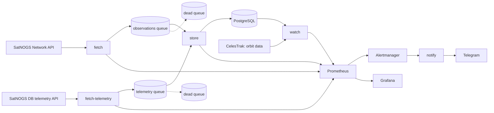

# satnogs-pipeline

Reads the radio telemetry of a real CubeSat ([UWE-4](https://en.wikipedia.org/wiki/UWE-4), University of Würzburg) from volunteer ground stations, decodes it, stores it, and raises an alert when a battery misbehaves. The alert knows whether the satellite is in sunlight or in the Earth's shadow, because a battery is supposed to discharge in the shadow.


The data comes from [SatNOGS](https://satnogs.org/), a worldwide network of volunteer ground stations. The lighting is worked out with the SGP4 orbit model from [orbitscreen](https://github.com/supremeinferno/orbitscreen) and the Sun's position, not read from the battery, which is what makes the picture above a check and not a circle.

## What it does



## Results

All measured on real UWE-4 data, 17 to 22 October 2026 (137 beacons over 5.1 days), unless it says otherwise.

| | |
|---|---|
| Lighting model against the batteries | In the shadow, **0 of 60** beacons were charging. In sunlight, 61 of 77 were. |
| Battery rule on the same history | Replayed at each of the 137 readings, "discharging in sunlight" and "low voltage" never fired. |
| Same rule on made-up readings | Three in the shadow at -300 mA (what "current is negative" would flag): no alert. Three in sunlight at -120 mA: alert, delivered to Telegram, resolved when removed. |
| Failure tests ([`scripts/chaos.sh`](scripts/chaos.sh)) | 6 breakages, 20 checks, about 30 seconds: store down, RabbitMQ restart, PostgreSQL down, duplicates, a message that is not JSON. |
| CI | gofmt, vet, tests with the race detector, `go.mod`, shell scripts, Prometheus and Alertmanager configuration, Docker image. |
| Kubernetes (kind) | 11 pods running without restarts, 5 Prometheus targets up, 10 alert rules loaded. |

## Where the real data corrected me

- The SatNOGS API's `status` filter still returns passes that have not happened yet, and for a busy satellite the first 140 results are all in the future. Filtering is done here, with a time cutoff.
- 38 of the first 72 telemetry frames have `observation_id` 0 (not uploaded through SatNOGS Network). I had treated that as invalid and sent good frames to the dead queue. They are stored with a NULL observation now.
- The telemetry API answers 429 every eight to ten seconds. A poll that failed on it started over from the first page and never finished. It now waits out the 429 on the same page.
- Most satellites' frames are no use: Morse code and APRS text carry no battery data. 75 satellites were scanned (slowly, because of that rate limit) to find one with a binary, documented beacon.
- One beacon with the battery discharging in sunlight is not an anomaly: 8 of 77 sunlit beacons do it, for a few tens of mA. The rule asks for three, 30 minutes apart.

## How it fits together

Five programs in one binary, so that a slow or dead part never stops the others:

- `fetch` polls the observations API on an interval, follows its pagination, skips passes that haven't happened yet, and publishes each new or changed observation. It waits for the broker's confirmation (publisher confirms) before counting a message as sent.
- `store` reads the queue and writes to Postgres. A message is acknowledged only after it is saved, so a crash loses nothing; an undecodable or invalid message goes to the dead queue instead of blocking the rest.
- `fetch-telemetry` reads raw radio frames of one satellite (UWE-4, NORAD 43880) from the SatNOGS DB API, which needs an account token (`SATNOGS_DB_TOKEN` in `.env`), and respects its rate limit (HTTP 429, `Retry-After`). `store` decodes each frame into battery voltage, current, temperature and charge ([uwe4.go](uwe4.go)), checks the frame's checksum, and keeps one row per distinct frame: the same beacon heard by two ground stations is stored once. Frames that are not beacons or arrive damaged are counted and dropped; only frames that can never work (bad JSON, an unknown satellite) go to the dead queue.
- `watch` applies battery rules that know whether the satellite is in sunlight (see [Battery watch](#battery-watch)) and exports the result as metrics.
- `notify` receives Alertmanager's webhook and sends each alert to Telegram (see [Alerts](#alerts)).
- Running any of them twice never duplicates a row; a row is updated only when its status or frame count changed.
- All of them survive their dependencies going down (API, broker, database) and shut down cleanly on Ctrl-C or SIGTERM.

## Run it

Needs Docker. Go 1.26+ is needed only for development.

```sh
docker compose up -d --build         # PostgreSQL, RabbitMQ, fetch and fetch-telemetry (every 5 minutes), store, Prometheus, Grafana, Alertmanager, notify
docker compose logs -f fetch store
docker compose down                  # stop; add -v to also delete the data
```

PostgreSQL applies `schema.sql` only when its volume is empty. After pulling a change to the schema, apply it to an existing database (it is written to be re-run): `docker compose exec -T postgres psql -U satnogs < schema.sql`.

For development, run only the infrastructure in Docker and the programs from source:

```sh
docker compose up -d postgres rabbitmq
go run . store                       # terminal 1: queue -> Postgres
go run . fetch -interval 0           # terminal 2: poll once and exit
go test ./...
```

`fetch` flags: `-interval` (0 = once), `-norad` (satellite catalog number, 0 = all; default 25544, the ISS), `-max-pages` (25 observations per page). Connections come from `DATABASE_URL` and `AMQP_URL`, defaulting to the ones in `docker-compose.yml`. The RabbitMQ management UI is at http://localhost:15672 (user and password `satnogs`).

## Failure tests

`scripts/chaos.sh` breaks the pipeline on purpose and checks that it recovers. It starts PostgreSQL, RabbitMQ and `store`, feeds made-up observations straight into the queue (the SatNOGS API is not called), and checks the database and the queues after each break:

1. normal operation: 5 observations reach the database;
2. `store` stopped: 20 messages wait in the queue and nothing is stored, then all are stored once it is back;
3. the same observations again: no duplicate rows;
4. RabbitMQ restarted: `store` reconnects by itself and stores new messages;
5. PostgreSQL stopped: messages stay in the queue, and all are stored when it is back;
6. a message that is not JSON goes to the dead queue, and the good messages behind it are still stored.

```sh
scripts/chaos.sh              # about 30 seconds once the images are built
scripts/chaos.sh --no-build
```

It exits non-zero if a check fails and removes its own rows. To see it fail, drop the primary key of `observations`: the script stops at step 1.

## Monitoring

Both programs serve Prometheus metrics on `:9100/metrics`. `docker compose up` also starts Prometheus (http://localhost:9090) and Grafana (http://localhost:3000, no login, local use only) with a ready dashboard, *SatNOGS pipeline*:

| Panel | What it tells you |
|---|---|
| Queue depth | Messages waiting for `store`. Rises when `store` is slow or stopped, drains when it catches up. |
| Dead queue | Messages that could never be stored. Should stay at 0. |
| Published / handled per second | Throughput of `fetch` and `store`, the latter split into stored, unchanged, rejected and failed. |
| Time since last successful poll | Should never be far above the poll interval. The thing to alert on. |
| SatNOGS API requests | Successes and errors. |
| Write to Postgres p95, pass end to stored p95 | Latency of the database write, and how long after a pass ended it reached the database (mostly ground stations uploading late). |

Counters are per process and restart from zero. The first poll after an empty start backfills a day or more of passes, which inflates the "pass end to stored" delay until real traffic dominates it.

## Alerts

Prometheus evaluates the rules in `monitoring/alerts.yml` and hands firing alerts to Alertmanager (http://localhost:9093), which posts them to the `notify` service. `notify` logs one line per alert (`docker compose logs notify`) and, when `TELEGRAM_TOKEN` and `TELEGRAM_CHAT_ID` are set in a git-ignored `.env` file, sends it to a Telegram chat. If delivery fails it answers 502 so Alertmanager sends the batch again. The bot token is part of Telegram's request URL, so errors are scrubbed before they reach the logs.

| Alert | Fires when |
|---|---|
| ServiceDown | `fetch` or `store` can't be scraped for 1 minute |
| PollStale | no successful SatNOGS poll for 15 minutes (the interval is 5) |
| APIErrors | more than 3 failed API requests in 10 minutes |
| QueueBacklog | more than 100 messages waiting for 2 minutes |
| DeadQueueNotEmpty | any message in the dead queue |
| StoreFailing | `store` failed to write a message in the last 5 minutes |

A stopped program exposes no metrics, so "time since last poll" can't notice it; that is what ServiceDown (`up == 0`) is for.

## Kubernetes

`k8s/` runs the whole pipeline on a local [kind](https://kind.sigs.k8s.io/) cluster (Kubernetes inside Docker): PostgreSQL, RabbitMQ, `fetch`, `fetch-telemetry`, `store` (2 replicas), `watch`, and Prometheus, Alertmanager, `notify` and Grafana with the same configuration files as Docker Compose. Needs Docker, kind and kubectl.

```sh
k8s/deploy.sh                                   # create the cluster, build and load the image, apply k8s/
kubectl --context kind-satnogs -n satnogs get pods
kubectl --context kind-satnogs -n satnogs port-forward svc/grafana 3000:3000
kubectl --context kind-satnogs -n satnogs scale deploy/store --replicas=4
kind delete cluster --name satnogs              # remove everything
```

- PostgreSQL and RabbitMQ are StatefulSets with a persistent volume each; the programs are Deployments (`store` runs 2 replicas that share the queue).
- Secrets that must not be in git (`SATNOGS_DB_TOKEN`, `TELEGRAM_TOKEN`, `TELEGRAM_CHAT_ID`) are created by `deploy.sh` from `.env`. Without a token `fetch-telemetry` is switched off; without Telegram credentials alerts are only logged. `deploy.sh` also applies `schema.sql` to an existing database.
- Nothing waits for anything: Kubernetes starts all pods at once and the programs retry until their dependencies answer. `fetch` retries a failed poll after 30 seconds, not after a whole interval.
- The Services are named as in Compose (`fetch`, `store`, `notify`, ...), so `monitoring/prometheus.yml` and `monitoring/alertmanager.yml` work unchanged in both; `deploy.sh` makes them into ConfigMaps.
- Checked on kind: all 11 pods run without restarts, Prometheus scrapes all five targets and loads the 10 alert rules, Grafana shows the dashboard. Earlier: deleting a `store` pod brings up a replacement, scaling `store` to 4 gives 4 consumers, deleting `postgres-0` keeps all rows.
- Not done: Prometheus and Grafana keep their data in the pod (lost on restart), no Ingress, the secrets are plain Kubernetes Secrets, and `scripts/chaos.sh` runs against Compose only.

## Battery watch

A battery that is discharging is only a problem if the satellite is in sunlight. In the Earth's shadow it has to discharge. So `watch` works out the lighting at each beacon: it takes the current element set (TLE) from CelesTrak, finds the satellite's position with the SGP4 propagator in `internal/sgp4`, finds the Sun with a low-precision series (`internal/orbit`), and tests whether the satellite is inside the Earth's shadow, modelled as a cylinder.

**Checked against the real batteries** (137 UWE-4 beacons over 5.1 days, battery A; `go run ./cmd/plotbattery` redraws the figure at the top and prints the numbers below from the database):

| Lighting (from SGP4) | Readings | Charging (> 20) | Discharging (< -20) | Flat |
|---|---|---|---|---|
| Sunlight | 77 | 61 | 8 | 8 |
| Shadow | 60 | **0** | 37 | 23 |

In the shadow the battery was never charging. The 8 sunlit readings that discharge (-26 to -162 mA) are not near the edge of the shadow (the nearest edge is at least 10 minutes 45 seconds away), so they are not errors of the model; most likely a load such as the radio. That is why one such reading is not an alert. "Flat" means within 20 mA of zero.

| Rule | Fires when |
|---|---|
| Discharging in sunlight | the newest 3 sunlit readings of a battery are all below -50 mA and span at least 30 minutes (so the beacons of one pass count once). Replayed at each of the 137 readings, it never fires. |
| Low voltage | the newest reading is below 3500 mV (the lowest seen was 3732 mV) |
| Telemetry stale | no beacon stored for 12 hours (the largest gap seen was 7.7 hours) |
| Orbit data stale | the TLE is more than 10 days old; the sunlight rule is then switched off |

**Tested with made-up readings** in the database: three readings in the shadow at -300 mA (what a plain "current is negative" rule would flag) raised nothing; three readings in sunlight at -120 mA raised `BatteryDischargingInSunlight` for both batteries, delivered to Telegram, and the alert resolved when the readings were removed.

Limits: the shadow is a cylinder, not the real cone with penumbra, which matters only for the few seconds around entering or leaving it. The TLE can be days old; its position error grows by about a kilometre a day, which moves the shadow edge by seconds. The SGP4 propagator and the TLE parser are [orbitscreen](https://github.com/supremeinferno/orbitscreen)'s `pkg/sgp4` and `pkg/tle`, imported as a Go module (verified there against Vallado's reference set).

## Notes on the data

- The API lists newest first, and for a busy satellite the first pages are all scheduled (future) passes, so requests carry a `start__lt=<now>` cutoff.
- Many recent observations are `unknown` until someone vets them. Observations older than the first page with no changes are not re-checked, so a late status change on an old row is missed.
- Observation frame data (`demoddata`) are links to files, not JSON; the telemetry API returns the raw frames directly.
- The telemetry API returns raw frames only: its `decoded` field is empty or just `"influxdb"`, so decoding is done here. Many satellites there send Morse (CW) or APRS text; UWE-4 sends binary beacons with a documented layout (SatNOGS's Kaitai definition), which is why it was chosen.
- `testdata/uwe4_frames.txt` holds a few real frames from the SatNOGS DB API. Check the data licence of SatNOGS DB before reusing them.
- `observation_id` is 0 for frames not uploaded through SatNOGS Network; they are real frames and are stored with a NULL observation.
- A poll that fails part-way (for example on a 429) makes the next poll read all pages again instead of stopping at the first page with nothing new, so the pages it never reached are not lost.
